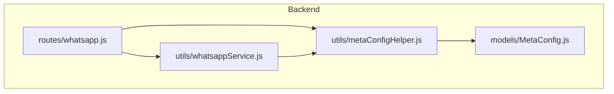
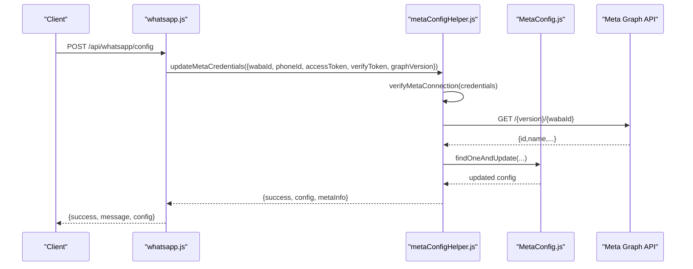
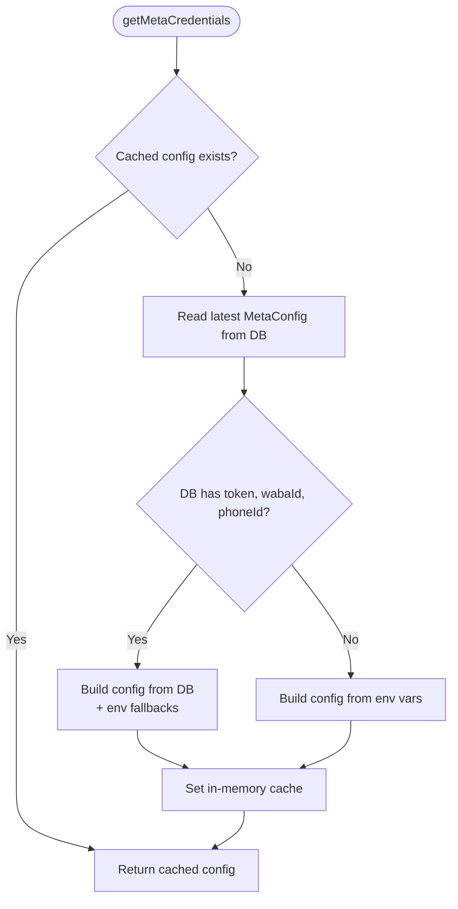
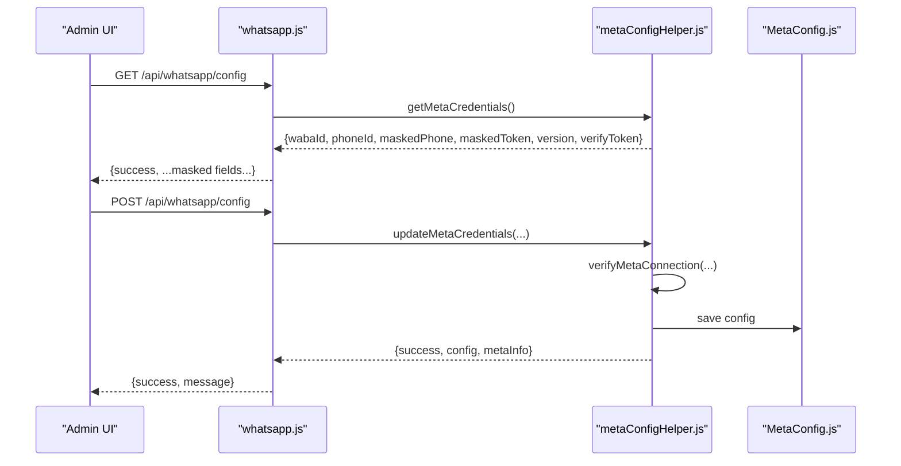
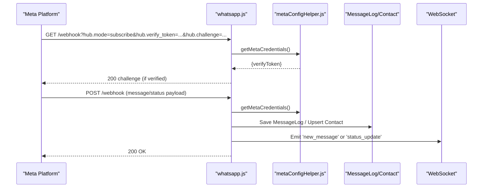
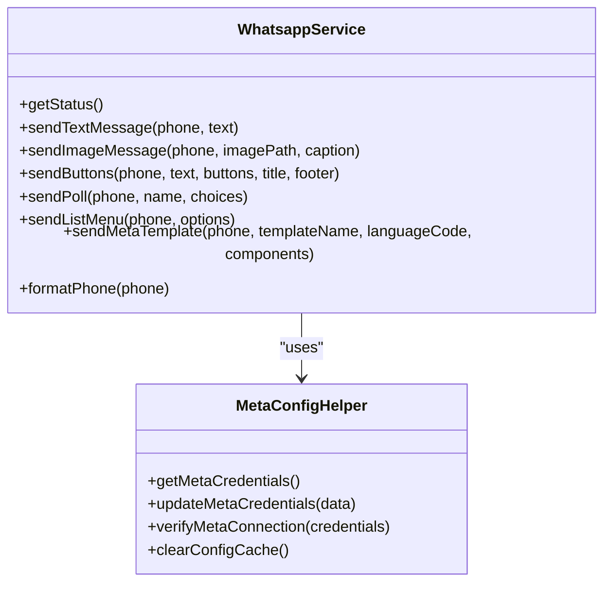
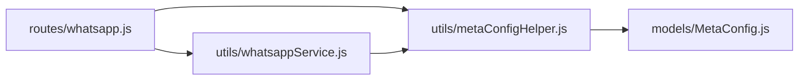

# Meta API Configuration and Setup

<cite>
**Referenced Files in This Document**
- [MetaConfig.js](file://backend/models/MetaConfig.js)
- [metaConfigHelper.js](file://backend/utils/metaConfigHelper.js)
- [whatsapp.js](file://backend/routes/whatsapp.js)
- [whatsappService.js](file://backend/utils/whatsappService.js)
</cite>

## Table of Contents
1. [Introduction](#introduction)
2. [Project Structure](#project-structure)
3. [Core Components](#core-components)
4. [Architecture Overview](#architecture-overview)
5. [Detailed Component Analysis](#detailed-component-analysis)
6. [Dependency Analysis](#dependency-analysis)
7. [Performance Considerations](#performance-considerations)
8. [Troubleshooting Guide](#troubleshooting-guide)
9. [Conclusion](#conclusion)
10. [Appendices](#appendices)

## Introduction
This document explains how to configure and operate the Meta Business API integration for WhatsApp in this project. It covers:
- Configuring WABA ID, Phone Number ID, Access Token, and Verify Token
- Credential storage using the MetaConfig model and environment variables
- Secure token handling and connection verification
- Webhook setup and testing
- Troubleshooting common configuration errors
- Security best practices for managing sensitive tokens and multiple WhatsApp Business accounts

## Project Structure
The backend implements a modular design:
- Data model for Meta credentials
- Helper utilities for credential resolution, caching, and validation
- Express routes for status, configuration management, and webhook handling
- WhatsApp service layer for sending messages and interacting with Meta Graph API

**Diagram sources**
- [whatsapp.js:1-10](file://backend/routes/whatsapp.js#L1-L10)
- [metaConfigHelper.js:1-10](file://backend/utils/metaConfigHelper.js#L1-L10)
- [MetaConfig.js:1-12](file://backend/models/MetaConfig.js#L1-L12)
- [whatsappService.js:1-10](file://backend/utils/whatsappService.js#L1-L10)

**Section sources**
- [whatsapp.js:1-10](file://backend/routes/whatsapp.js#L1-L10)
- [metaConfigHelper.js:1-10](file://backend/utils/metaConfigHelper.js#L1-L10)
- [MetaConfig.js:1-12](file://backend/models/MetaConfig.js#L1-L12)
- [whatsappService.js:1-10](file://backend/utils/whatsappService.js#L1-L10)

## Core Components
- MetaConfig model: Stores WABA ID, Phone Number ID, Access Token, Verify Token, and Graph API version. Includes an update timestamp.
- metaConfigHelper: Provides functions to get credentials (with cache), update credentials (with live validation), verify connection, and clear cache.
- whatsapp routes: Expose endpoints for status, configuration retrieval/update, environment sync, and webhook handling.
- whatsappService: Builds requests to Meta Graph API using resolved credentials and supports text, media, buttons, lists, polls, and templates.

Key responsibilities:
- Credential resolution order: database first, then environment variables.
- In-memory caching of credentials to reduce DB calls.
- Live connectivity check against Meta Graph API before persisting credentials.
- Webhook verification and message/status processing.

**Section sources**
- [MetaConfig.js:3-10](file://backend/models/MetaConfig.js#L3-L10)
- [metaConfigHelper.js:6-35](file://backend/utils/metaConfigHelper.js#L6-L35)
- [metaConfigHelper.js:37-71](file://backend/utils/metaConfigHelper.js#L37-L71)
- [metaConfigHelper.js:73-100](file://backend/utils/metaConfigHelper.js#L73-L100)
- [whatsapp.js:8-59](file://backend/routes/whatsapp.js#L8-L59)
- [whatsapp.js:78-109](file://backend/routes/whatsapp.js#L78-L109)
- [whatsapp.js:114-132](file://backend/routes/whatsapp.js#L114-L132)
- [whatsappService.js:7-23](file://backend/utils/whatsappService.js#L7-L23)

## Architecture Overview
The system integrates three layers:
- API Layer (Express routes): Accepts configuration updates, returns status, and handles webhooks.
- Service Layer (whatsappService): Formats payloads and calls Meta Graph API endpoints.
- Configuration Layer (metaConfigHelper + MetaConfig): Resolves and validates credentials from MongoDB or environment variables.

**Diagram sources**
- [whatsapp.js:78-109](file://backend/routes/whatsapp.js#L78-L109)
- [metaConfigHelper.js:37-71](file://backend/utils/metaConfigHelper.js#L37-L71)
- [metaConfigHelper.js:73-100](file://backend/utils/metaConfigHelper.js#L73-L100)
- [MetaConfig.js:3-10](file://backend/models/MetaConfig.js#L3-L10)

## Detailed Component Analysis

### MetaConfig Model
Stores the following fields:
- wabaId: Meta Business Account ID
- phoneId: WhatsApp Phone Number ID
- accessToken: Meta Graph API access token
- verifyToken: Webhook verification token
- graphVersion: Meta Graph API version
- updatedAt: Last update timestamp

Validation and defaults are enforced at the schema level. The default verifyToken is provided but can be overridden via environment variables or runtime updates.

**Section sources**
- [MetaConfig.js:3-10](file://backend/models/MetaConfig.js#L3-L10)

### Credential Resolution and Storage (metaConfigHelper)
Credential resolution logic:
- Reads from MongoDB (most recent record). If present and complete, returns cached credentials.
- Falls back to environment variables if DB is missing or incomplete.
- Caches credentials in memory to avoid repeated DB reads.

Update flow:
- Validates credentials by calling Meta Graph API before saving.
- Persists credentials to MongoDB with upsert semantics.
- Updates in-memory cache.

Verification function:
- Calls Meta Graph API to confirm reachability and fetch business account metadata.
- Returns structured result indicating success or error details.

Cache control:
- Provides a function to clear the in-memory cache when environment changes.

**Diagram sources**
- [metaConfigHelper.js:6-35](file://backend/utils/metaConfigHelper.js#L6-L35)

**Section sources**
- [metaConfigHelper.js:6-35](file://backend/utils/metaConfigHelper.js#L6-L35)
- [metaConfigHelper.js:37-71](file://backend/utils/metaConfigHelper.js#L37-L71)
- [metaConfigHelper.js:73-100](file://backend/utils/metaConfigHelper.js#L73-L100)
- [metaConfigHelper.js:102-104](file://backend/utils/metaConfigHelper.js#L102-L104)

### WhatsApp Routes (Configuration and Webhooks)
Endpoints:
- GET /status: Returns connection status based on live verification.
- GET /config: Returns current configuration with masked sensitive values.
- POST /config: Validates and saves new credentials after live verification.
- POST /sync-env: Clears MongoDB MetaConfig and re-syncs with environment variables.
- GET /webhook: Handles Meta’s verification challenge.
- POST /webhook: Processes incoming messages and delivery/read statuses.

Security considerations:
- Sensitive fields are masked in responses.
- Webhook verification uses the configured verifyToken.

**Diagram sources**
- [whatsapp.js:38-59](file://backend/routes/whatsapp.js#L38-L59)
- [whatsapp.js:78-109](file://backend/routes/whatsapp.js#L78-L109)
- [metaConfigHelper.js:37-71](file://backend/utils/metaConfigHelper.js#L37-L71)

**Section sources**
- [whatsapp.js:8-22](file://backend/routes/whatsapp.js#L8-L22)
- [whatsapp.js:33-36](file://backend/routes/whatsapp.js#L33-L36)
- [whatsapp.js:38-59](file://backend/routes/whatsapp.js#L38-L59)
- [whatsapp.js:61-76](file://backend/routes/whatsapp.js#L61-L76)
- [whatsapp.js:78-109](file://backend/routes/whatsapp.js#L78-L109)
- [whatsapp.js:114-132](file://backend/routes/whatsapp.js#L114-L132)
- [whatsapp.js:135-311](file://backend/routes/whatsapp.js#L135-L311)

### Webhook Handling Flow
Webhook verification:
- Meta sends GET /webhook with hub.mode, hub.verify_token, and hub.challenge.
- Server compares hub.verify_token with configured verifyToken and responds with the challenge if valid.

Incoming messages:
- Extracts sender phone, message content, and metadata.
- Normalizes phone numbers and persists logs.
- Upserts contact records automatically.
- Emits real-time events via WebSocket.
- Triggers automation bot engine.

Status updates:
- Parses delivery/read statuses and error details.
- Persists status logs and emits real-time events.

**Diagram sources**
- [whatsapp.js:114-132](file://backend/routes/whatsapp.js#L114-L132)
- [whatsapp.js:135-311](file://backend/routes/whatsapp.js#L135-L311)
- [metaConfigHelper.js:6-35](file://backend/utils/metaConfigHelper.js#L6-L35)

**Section sources**
- [whatsapp.js:114-132](file://backend/routes/whatsapp.js#L114-L132)
- [whatsapp.js:135-311](file://backend/routes/whatsapp.js#L135-L311)

### WhatsApp Service Layer
Responsibilities:
- Resolve credentials and build base URLs for messaging and media endpoints.
- Format phone numbers to required format.
- Send text, images, buttons, polls, list menus, and template messages.
- Handle media upload to Meta when needed.

Error handling:
- Logs detailed Meta API errors and throws user-facing errors.

**Diagram sources**
- [whatsappService.js:7-23](file://backend/utils/whatsappService.js#L7-L23)
- [whatsappService.js:45-59](file://backend/utils/whatsappService.js#L45-L59)
- [whatsappService.js:61-78](file://backend/utils/whatsappService.js#L61-L78)
- [whatsappService.js:80-123](file://backend/utils/whatsappService.js#L80-L123)
- [whatsappService.js:125-152](file://backend/utils/whatsappService.js#L125-L152)
- [whatsappService.js:154-160](file://backend/utils/whatsappService.js#L154-L160)
- [whatsappService.js:162-192](file://backend/utils/whatsappService.js#L162-L192)
- [whatsappService.js:194-215](file://backend/utils/whatsappService.js#L194-L215)
- [metaConfigHelper.js:6-35](file://backend/utils/metaConfigHelper.js#L6-L35)

**Section sources**
- [whatsappService.js:7-23](file://backend/utils/whatsappService.js#L7-L23)
- [whatsappService.js:45-59](file://backend/utils/whatsappService.js#L45-L59)
- [whatsappService.js:61-78](file://backend/utils/whatsappService.js#L61-L78)
- [whatsappService.js:80-123](file://backend/utils/whatsappService.js#L80-L123)
- [whatsappService.js:125-152](file://backend/utils/whatsappService.js#L125-L152)
- [whatsappService.js:154-160](file://backend/utils/whatsappService.js#L154-L160)
- [whatsappService.js:162-192](file://backend/utils/whatsappService.js#L162-L192)
- [whatsappService.js:194-215](file://backend/utils/whatsappService.js#L194-L215)

## Dependency Analysis
- whatsapp.js depends on metaConfigHelper for credential resolution and validation, and on whatsappService for status checks.
- metaConfigHelper depends on MetaConfig model for persistence and axios for HTTP calls to Meta Graph API.
- whatsappService depends on metaConfigHelper for credentials and axios/form-data for API interactions.

**Diagram sources**
- [whatsapp.js:1-10](file://backend/routes/whatsapp.js#L1-L10)
- [metaConfigHelper.js:1-10](file://backend/utils/metaConfigHelper.js#L1-L10)
- [MetaConfig.js:1-12](file://backend/models/MetaConfig.js#L1-L12)
- [whatsappService.js:1-10](file://backend/utils/whatsappService.js#L1-L10)

**Section sources**
- [whatsapp.js:1-10](file://backend/routes/whatsapp.js#L1-L10)
- [metaConfigHelper.js:1-10](file://backend/utils/metaConfigHelper.js#L1-L10)
- [MetaConfig.js:1-12](file://backend/models/MetaConfig.js#L1-L12)
- [whatsappService.js:1-10](file://backend/utils/whatsappService.js#L1-L10)

## Performance Considerations
- In-memory caching of credentials reduces database load and latency.
- Live verification calls have timeouts to prevent hanging requests.
- Masking sensitive data in API responses avoids accidental exposure.
- Media uploads use streaming to handle large files efficiently.

[No sources needed since this section provides general guidance]

## Troubleshooting Guide
Common issues and resolutions:
- Missing credentials: Ensure WABA ID, Phone Number ID, and Access Token are set either in MongoDB or environment variables.
- Invalid token or WABA ID: Use the configuration endpoint to validate; the helper performs a live call to Meta Graph API and reports errors.
- Webhook verification failures: Confirm that the verifyToken matches what you configured in Meta Developer Console.
- Environment sync: Use the sync endpoint to clear MongoDB MetaConfig and force the app to read from environment variables.
- Connection status: Use the status endpoint to see CONNECTED/DISCONNECTED and any error messages.

Operational tips:
- Always test credentials before saving them.
- Keep verifyToken consistent between Meta console and your server configuration.
- Monitor logs for Meta API errors and webhook processing errors.

**Section sources**
- [metaConfigHelper.js:73-100](file://backend/utils/metaConfigHelper.js#L73-L100)
- [whatsapp.js:8-22](file://backend/routes/whatsapp.js#L8-L22)
- [whatsapp.js:61-76](file://backend/routes/whatsapp.js#L61-L76)
- [whatsapp.js:114-132](file://backend/routes/whatsapp.js#L114-L132)

## Conclusion
This integration centralizes Meta Business API configuration through a secure, validated, and cached credential store. It exposes straightforward endpoints for configuration management and robust webhook handling for real-time messaging. By following the steps below, you can reliably connect, verify, and operate WhatsApp Business messaging within this application.

[No sources needed since this section summarizes without analyzing specific files]

## Appendices

### Step-by-Step: Obtaining Meta API Credentials
- Create a Meta Business Manager account and a WhatsApp Business App in the Meta Developer Console.
- Generate a User Access Token with WhatsApp Business permissions.
- Retrieve your WABA ID (Business Account ID) and Phone Number ID from the WhatsApp settings in the Meta console.
- Set a custom Verify Token for webhook verification.

[No sources needed since this section provides general guidance]

### Step-by-Step: Setting Up Webhook URL
- Deploy your backend so it is publicly reachable.
- Configure the webhook URL in Meta Developer Console to point to your server’s /webhook endpoint.
- Provide the same Verify Token used in your server configuration.
- Test the connection; Meta will send a verification challenge which your server must accept.

**Section sources**
- [whatsapp.js:114-132](file://backend/routes/whatsapp.js#L114-L132)

### Step-by-Step: Testing API Connectivity
- Call the status endpoint to verify connection.
- Use the configuration endpoint to submit credentials; the helper will perform a live verification call.
- Inspect the response for success or error details.

**Section sources**
- [whatsapp.js:8-22](file://backend/routes/whatsapp.js#L8-L22)
- [whatsapp.js:78-109](file://backend/routes/whatsapp.js#L78-L109)
- [metaConfigHelper.js:73-100](file://backend/utils/metaConfigHelper.js#L73-L100)

### Security Best Practices
- Store sensitive tokens in environment variables or a secrets manager; avoid hardcoding.
- Mask tokens in API responses to prevent leakage.
- Rotate Access Tokens periodically and update via the configuration endpoint.
- For multiple WhatsApp Business accounts, maintain separate configurations and switch contexts by updating credentials accordingly.
- Restrict access to configuration endpoints behind authentication and authorization controls.

[No sources needed since this section provides general guidance]