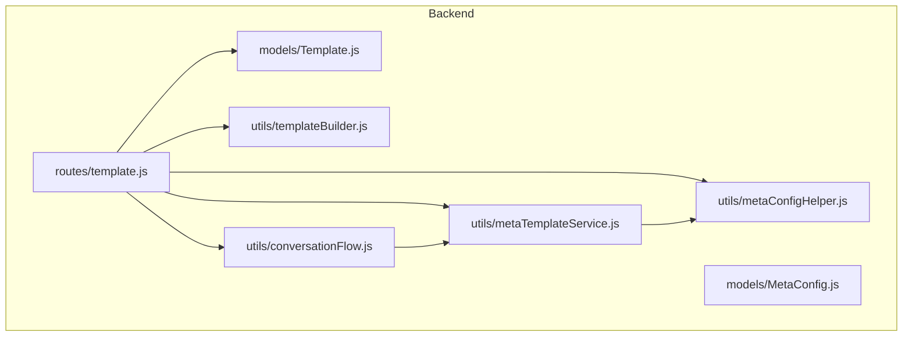
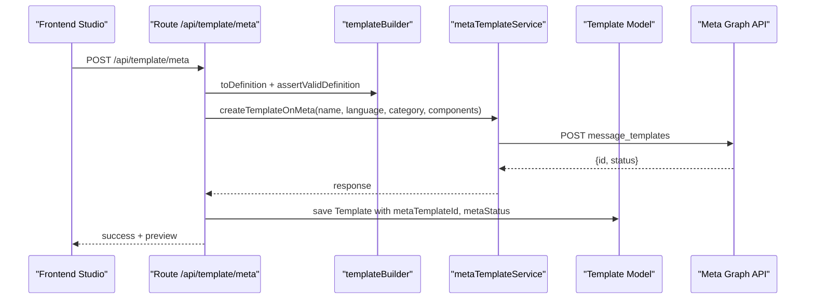
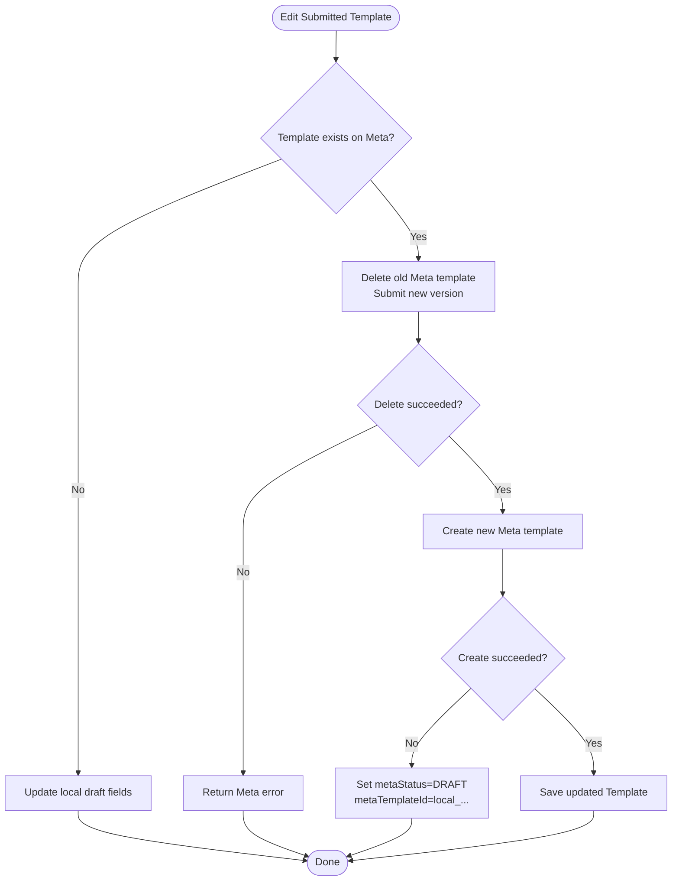
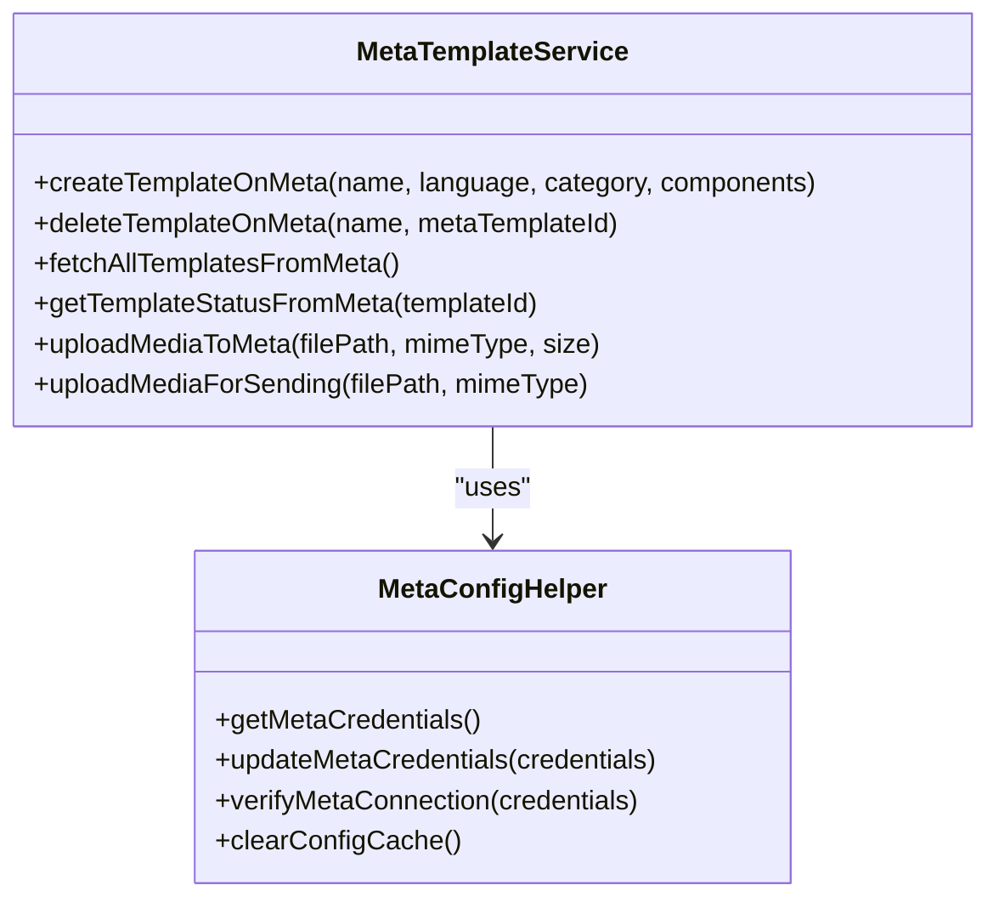
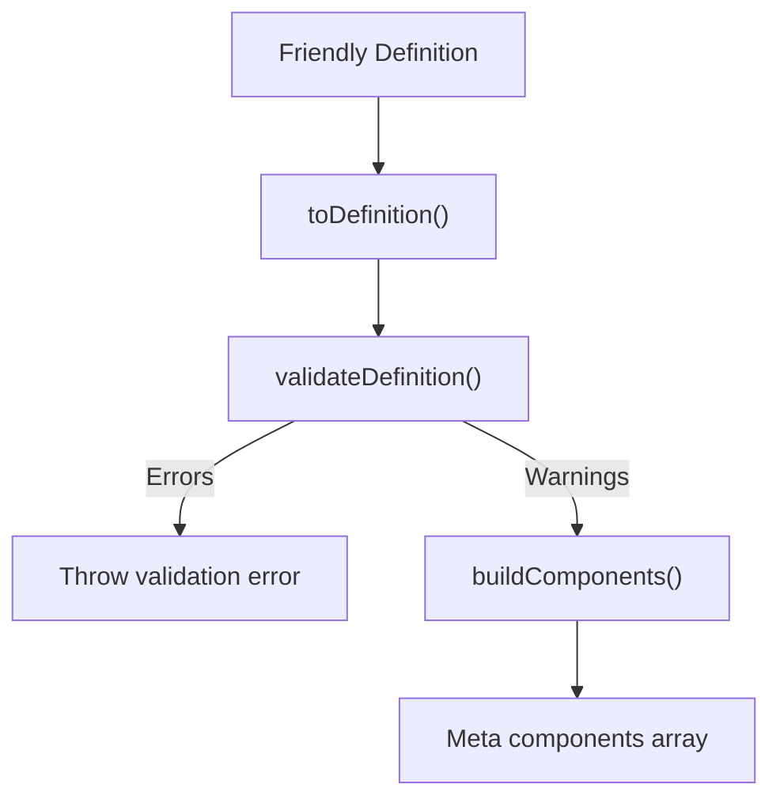
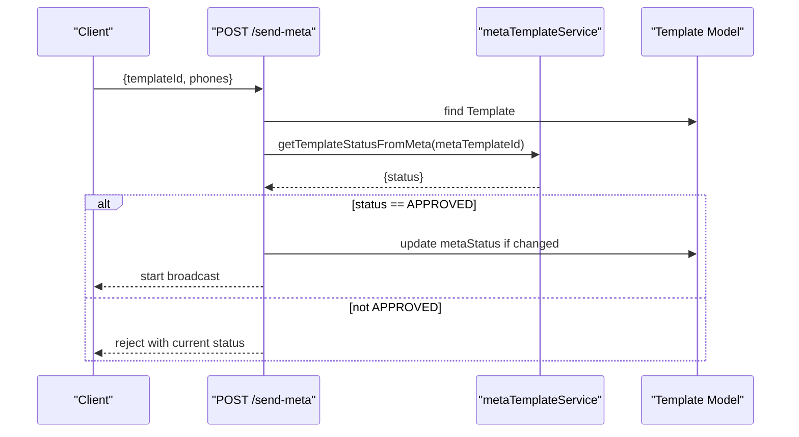
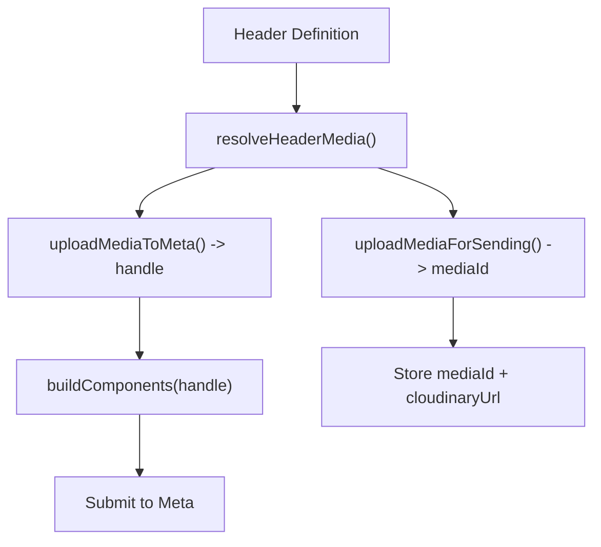
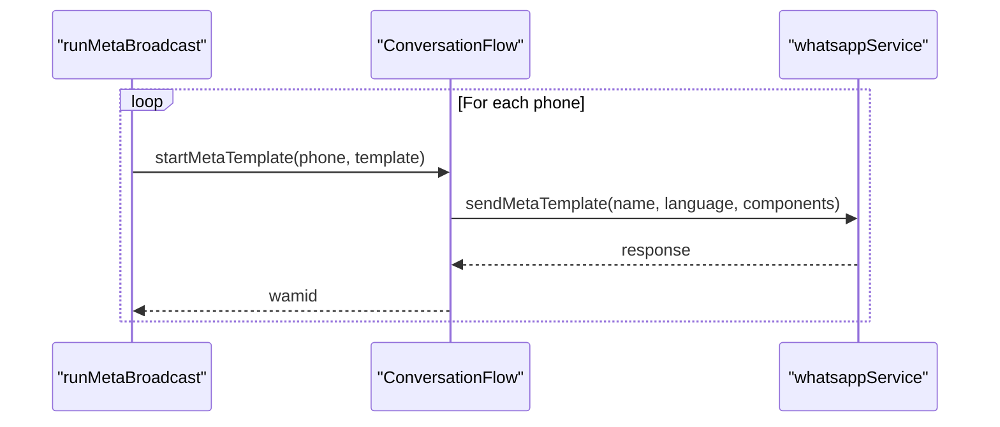
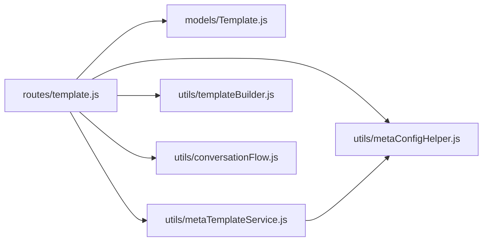

# Template Management and Synchronization

<cite>
**Referenced Files in This Document**
- [Template.js](file://backend/models/Template.js)
- [MetaConfig.js](file://backend/models/MetaConfig.js)
- [template.js](file://backend/routes/template.js)
- [metaTemplateService.js](file://backend/utils/metaTemplateService.js)
- [metaConfigHelper.js](file://backend/utils/metaConfigHelper.js)
- [conversationFlow.js](file://backend/utils/conversationFlow.js)
- [templateBuilder.js](file://backend/utils/templateBuilder.js)
</cite>

## Table of Contents
1. [Introduction](#introduction)
2. [Project Structure](#project-structure)
3. [Core Components](#core-components)
4. [Architecture Overview](#architecture-overview)
5. [Detailed Component Analysis](#detailed-component-analysis)
6. [Dependency Analysis](#dependency-analysis)
7. [Performance Considerations](#performance-considerations)
8. [Troubleshooting Guide](#troubleshooting-guide)
9. [Conclusion](#conclusion)

## Introduction
This document explains how the application manages WhatsApp templates, synchronizes them with Meta’s Graph API, and deploys approved templates to end users. It covers:
- The template lifecycle from creation through Meta approval, versioning, and deployment.
- The service layer that communicates with Meta’s template and media APIs.
- Local template storage, synchronization, and deprecation handling.
- Parameter binding for dynamic content and template testing workflows.
- Caching strategies and performance optimizations.

The system supports three Meta template categories: MARKETING, UTILITY, and AUTHENTICATION. Templates are validated locally before submission, then stored locally with a mirror of Meta’s state. Sending is restricted to templates that are APPROVED on Meta at send time.

## Project Structure
The template management feature spans models, routes, utilities, and services:
- Models define local persistence for templates and Meta configuration.
- Routes expose endpoints for creating, updating, importing, scheduling, and sending templates.
- Utilities implement validation, component building, parameter normalization, and Meta API calls.
- A conversation flow utility orchestrates sending approved templates with dynamic parameters.

**Diagram sources**
- [template.js:1-30](file://backend/routes/template.js#L1-L30)
- [metaTemplateService.js:1-21](file://backend/utils/metaTemplateService.js#L1-L21)
- [metaConfigHelper.js:1-35](file://backend/utils/metaConfigHelper.js#L1-L35)
- [templateBuilder.js:1-24](file://backend/utils/templateBuilder.js#L1-L24)
- [conversationFlow.js:1-8](file://backend/utils/conversationFlow.js#L1-L8)

**Section sources**
- [Template.js:1-70](file://backend/models/Template.js#L1-L70)
- [MetaConfig.js:1-13](file://backend/models/MetaConfig.js#L1-L13)
- [template.js:1-40](file://backend/routes/template.js#L1-L40)

## Core Components
- Template model: Stores both legacy fields and Meta-specific metadata such as name, category, language, components, metaTemplateId, metaStatus, and WABA association.
- MetaConfig model: Holds WABA ID, phone number ID, access token, verify token, and Graph API version.
- Template routes: Provide endpoints for creating, updating, recreating, deleting, listing, importing, scheduling, and sending templates via Meta.
- Meta template service: Encapsulates Graph API calls for template CRUD, status checks, and media uploads (resumable upload handle and media ID).
- Meta config helper: Loads credentials with in-process caching and validates connectivity to Meta.
- Template builder: Normalizes UI payloads into canonical definitions, builds Meta components, enforces rules, and formats Meta errors.
- Conversation flow: Builds per-send components (header media, body parameters), resolves media IDs or links, and sends via Meta Cloud API.

**Section sources**
- [Template.js:3-68](file://backend/models/Template.js#L3-L68)
- [MetaConfig.js:3-10](file://backend/models/MetaConfig.js#L3-L10)
- [template.js:146-199](file://backend/routes/template.js#L146-L199)
- [metaTemplateService.js:114-179](file://backend/utils/metaTemplateService.js#L114-L179)
- [metaConfigHelper.js:6-35](file://backend/utils/metaConfigHelper.js#L6-L35)
- [templateBuilder.js:178-289](file://backend/utils/templateBuilder.js#L178-L289)
- [conversationFlow.js:21-118](file://backend/utils/conversationFlow.js#L21-L118)

## Architecture Overview
The template lifecycle flows through these stages:
1. Creation: The UI submits a friendly definition; the backend normalizes it, validates it, resolves header media, builds components, and creates the template on Meta.
2. Approval: Meta returns a status (e.g., PENDING, IN_REVIEW, APPROVED, REJECTED). The backend stores this status locally.
3. Versioning: Editing an already-submitted template requires recreation, which deletes the old Meta version and submits a new one under the same name.
4. Deployment: Before sending, the backend verifies the template is APPROVED on Meta, then constructs per-message components and sends via Meta Cloud API.

**Diagram sources**
- [template.js:726-765](file://backend/routes/template.js#L726-L765)
- [templateBuilder.js:178-289](file://backend/utils/templateBuilder.js#L178-L289)
- [metaTemplateService.js:114-137](file://backend/utils/metaTemplateService.js#L114-L137)

## Detailed Component Analysis

### Template Lifecycle and Versioning
- Creation:
  - Normalize and validate the definition.
  - Resolve header media to obtain a resumable upload handle required by Meta for template creation.
  - Build components and submit to Meta.
  - Persist the template with Meta’s id and status.
- Approval workflow:
  - Status is mirrored from Meta to local metaStatus.
  - Send endpoint enforces APPROVED status by querying Meta immediately before dispatch.
- Versioning:
  - Editing a submitted template triggers recreation: delete the existing Meta template and submit a replacement.
  - If deletion fails but the template exists on Meta, the route preserves the record and surfaces the error.
  - If recreation fails after deletion, the local record is downgraded to a local draft.

**Diagram sources**
- [template.js:255-287](file://backend/routes/template.js#L255-L287)
- [template.js:547-671](file://backend/routes/template.js#L547-L671)

**Section sources**
- [template.js:146-199](file://backend/routes/template.js#L146-L199)
- [template.js:255-287](file://backend/routes/template.js#L255-L287)
- [template.js:547-671](file://backend/routes/template.js#L547-L671)

### Meta API Service Layer
Responsibilities:
- Credential resolution and base URL construction.
- Template CRUD against Meta Graph API.
- Media uploads:
  - Resumable upload handle for template creation.
  - Media ID for sending messages.
- Error wrapping with structured metaError objects.

Key behaviors:
- Body variables are normalized to positional placeholders and example samples are generated when missing.
- Buttons are sanitized and limited to Meta constraints.
- Fetch-all and status queries support sync and pre-send verification.

**Diagram sources**
- [metaTemplateService.js:114-245](file://backend/utils/metaTemplateService.js#L114-L245)
- [metaConfigHelper.js:6-71](file://backend/utils/metaConfigHelper.js#L6-L71)

**Section sources**
- [metaTemplateService.js:1-21](file://backend/utils/metaTemplateService.js#L1-L21)
- [metaTemplateService.js:23-112](file://backend/utils/metaTemplateService.js#L23-L112)
- [metaTemplateService.js:114-179](file://backend/utils/metaTemplateService.js#L114-L179)
- [metaTemplateService.js:192-245](file://backend/utils/metaTemplateService.js#L192-L245)
- [metaConfigHelper.js:6-35](file://backend/utils/metaConfigHelper.js#L6-L35)

### Template Builder and Validation
Responsibilities:
- Convert UI-friendly definitions into canonical definitions.
- Build Meta components arrays with correct types and limits.
- Enforce naming, length, variable, and button rules.
- Generate helpful hints for common Meta error codes.

Highlights:
- Canonicalization converts named variables like {{name}} to positional {{1}}, {{2}} and ensures examples match.
- Category presets and rules are shared with the frontend.
- Utility templates receive warnings if copy reads promotional.

**Diagram sources**
- [templateBuilder.js:178-289](file://backend/utils/templateBuilder.js#L178-L289)
- [templateBuilder.js:300-415](file://backend/utils/templateBuilder.js#L300-L415)

**Section sources**
- [templateBuilder.js:12-24](file://backend/utils/templateBuilder.js#L12-L24)
- [templateBuilder.js:123-168](file://backend/utils/templateBuilder.js#L123-L168)
- [templateBuilder.js:178-289](file://backend/utils/templateBuilder.js#L178-L289)
- [templateBuilder.js:300-415](file://backend/utils/templateBuilder.js#L300-L415)
- [templateBuilder.js:421-493](file://backend/utils/templateBuilder.js#L421-L493)

### Local Template Storage and Sync
- Local schema mirrors Meta fields plus legacy fields for backward compatibility.
- Templates are filtered by WABA when listing.
- Import endpoint fetches a template by Meta ID and persists it locally.
- Deletion attempts to remove the template from Meta first, then removes the local record.

Sync mechanisms:
- Pre-send verification: The send endpoint queries Meta to confirm APPROVED status and updates local metaStatus if needed.
- Recreation path: When editing submitted templates, the old Meta version is deleted and a new one is created; local state reflects the new version or falls back to a local draft.

**Diagram sources**
- [template.js:397-441](file://backend/routes/template.js#L397-L441)
- [metaTemplateService.js:181-190](file://backend/utils/metaTemplateService.js#L181-L190)

**Section sources**
- [Template.js:3-68](file://backend/models/Template.js#L3-L68)
- [template.js:711-720](file://backend/routes/template.js#L711-L720)
- [template.js:770-800](file://backend/routes/template.js#L770-L800)
- [template.js:506-541](file://backend/routes/template.js#L506-L541)
- [template.js:397-441](file://backend/routes/template.js#L397-L441)

### Parameter Substitution and Testing
- Header media:
  - For image/video/document headers, the route resolves a file source (uploaded, remote URL, or local path), obtains a resumable handle for template creation, and also uploads a media ID for sending.
  - A public Cloudinary URL is stored for dashboard previews.
- Body parameters:
  - Variables are normalized to positional placeholders and sample values are auto-generated if missing.
  - At send time, the conversation flow injects dynamic values (for example, customer name) into the body parameters.
- Testing:
  - The create/update responses include preview components and sample values so the studio can validate rendering before submission.

**Diagram sources**
- [template.js:78-140](file://backend/routes/template.js#L78-L140)
- [metaTemplateService.js:192-245](file://backend/utils/metaTemplateService.js#L192-L245)

**Section sources**
- [template.js:78-140](file://backend/routes/template.js#L78-L140)
- [template.js:172-199](file://backend/routes/template.js#L172-L199)
- [conversationFlow.js:21-118](file://backend/utils/conversationFlow.js#L21-L118)

### Sending Approved Templates
- Broadcast runner:
  - Validates that the template has a valid Meta ID.
  - Verifies APPROVED status on Meta right before sending.
  - Iterates over recipients, sends via ConversationFlow.startMetaTemplate, logs outcomes, and updates counters.
- Conversation flow:
  - Normalizes phone numbers.
  - Builds header media using either a stored media ID or a link.
  - Injects body parameters when variables exist.
  - Sends via Meta Cloud API.

**Diagram sources**
- [template.js:319-391](file://backend/routes/template.js#L319-L391)
- [conversationFlow.js:21-118](file://backend/utils/conversationFlow.js#L21-L118)

**Section sources**
- [template.js:319-391](file://backend/routes/template.js#L319-L391)
- [conversationFlow.js:21-118](file://backend/utils/conversationFlow.js#L21-L118)

## Dependency Analysis
- Routes depend on:
  - Template model for persistence.
  - metaTemplateService for Graph API operations.
  - metaConfigHelper for credentials.
  - templateBuilder for normalization/validation.
  - conversationFlow for sending.
- Services depend on:
  - metaConfigHelper for credentials and caching.
- Models are independent data schemas.

**Diagram sources**
- [template.js:1-30](file://backend/routes/template.js#L1-L30)
- [metaTemplateService.js:1-4](file://backend/utils/metaTemplateService.js#L1-L4)
- [metaConfigHelper.js:1-3](file://backend/utils/metaConfigHelper.js#L1-L3)

**Section sources**
- [template.js:1-30](file://backend/routes/template.js#L1-L30)
- [metaTemplateService.js:1-4](file://backend/utils/metaTemplateService.js#L1-L4)
- [metaConfigHelper.js:1-3](file://backend/utils/metaConfigHelper.js#L1-L3)

## Performance Considerations
- Credential caching:
  - In-process cache avoids repeated database lookups for Meta credentials.
- Media handling:
  - Resumable upload handles are used for template creation to satisfy Meta requirements.
  - Separate media ID upload is performed for sending to avoid re-uploads during broadcasts.
- Send throttling:
  - Small delays between sends reduce rate-limit pressure.
- Local preview assets:
  - Storing Cloudinary URLs improves dashboard performance by avoiding repeated server-side conversions.

Recommendations:
- Cache resolved header handles and media IDs where appropriate to reduce redundant uploads.
- Batch import/sync operations with pagination and deduplication.
- Use background jobs for large broadcasts to avoid request timeouts.

[No sources needed since this section provides general guidance]

## Troubleshooting Guide
Common issues and resolutions:
- Invalid or expired access token:
  - Symptom: HTTP 401-like behavior from Meta.
  - Resolution: Regenerate System User token in Meta Business Settings and update credentials.
- Header media errors:
  - Symptom: Meta rejects header_handle or media format mismatch.
  - Resolution: Re-upload image (JPEG/PNG under 5 MB) and ensure correct MIME type.
- Example value count mismatch:
  - Symptom: Meta reports example values do not match variables.
  - Resolution: Ensure sample values match the number of {{n}} placeholders.
- Template not found:
  - Symptom: Sending fails because Meta does not recognize the template.
  - Resolution: Sync templates from Meta or recreate the template.
- Category mismatch:
  - Symptom: Meta rejects category selection.
  - Resolution: Use MARKETING for promotions; use UTILITY for transactional notifications.
- Outside 24-hour window:
  - Symptom: Messages blocked due to policy.
  - Resolution: Send an approved template to reopen the conversation.

Operational tips:
- Always verify APPROVED status before sending.
- Use the recreate flow for edits to submitted templates.
- Inspect metaError details and hints returned by the backend.

**Section sources**
- [template.js:222-247](file://backend/routes/template.js#L222-L247)
- [template.js:397-441](file://backend/routes/template.js#L397-L441)
- [templateBuilder.js:421-493](file://backend/utils/templateBuilder.js#L421-L493)

## Conclusion
The template management system provides a robust pipeline for creating, validating, submitting, and deploying WhatsApp templates through Meta’s Graph API. It enforces Meta’s rules locally, mirrors Meta’s approval state, and ensures only approved templates are sent. The architecture separates concerns across routes, services, builders, and models, enabling clear maintenance and extensibility. With careful attention to credential caching, media handling, and send throttling, the system delivers reliable performance for template operations at scale.