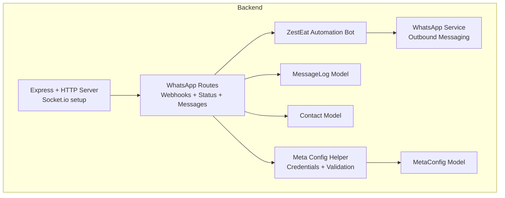
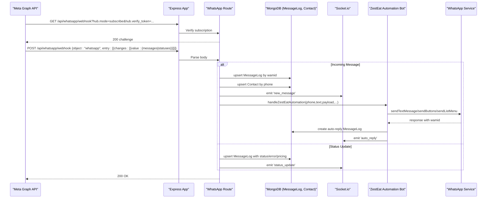
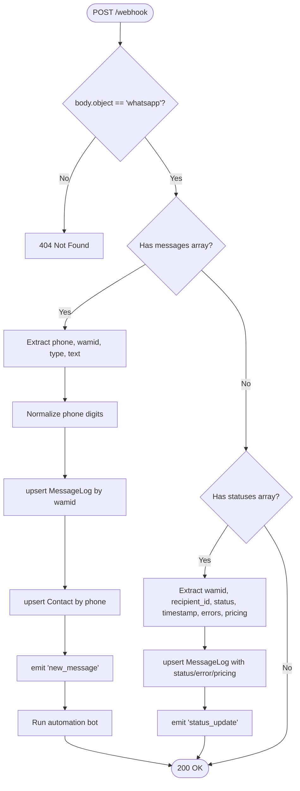
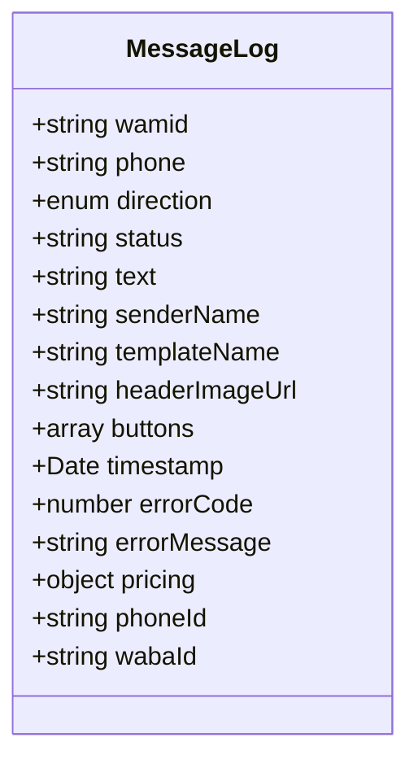
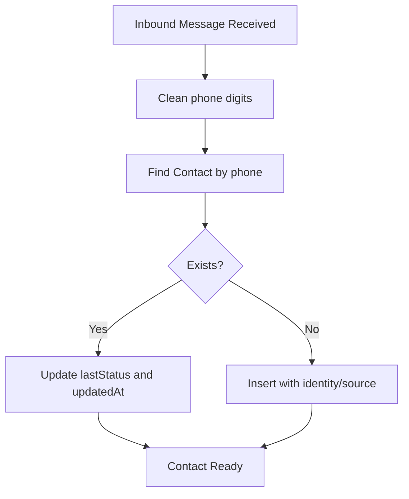
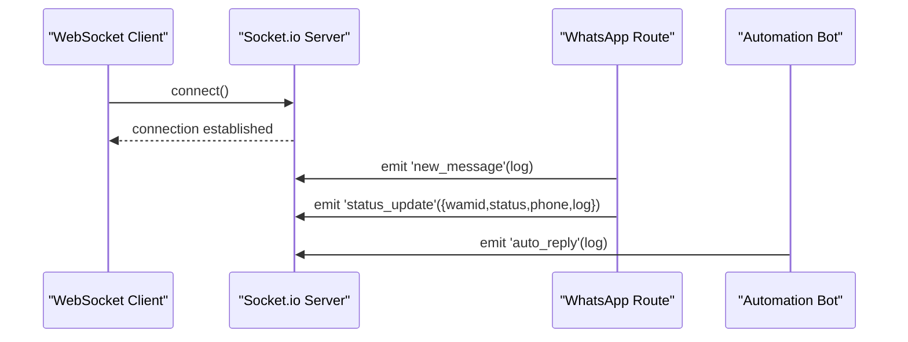
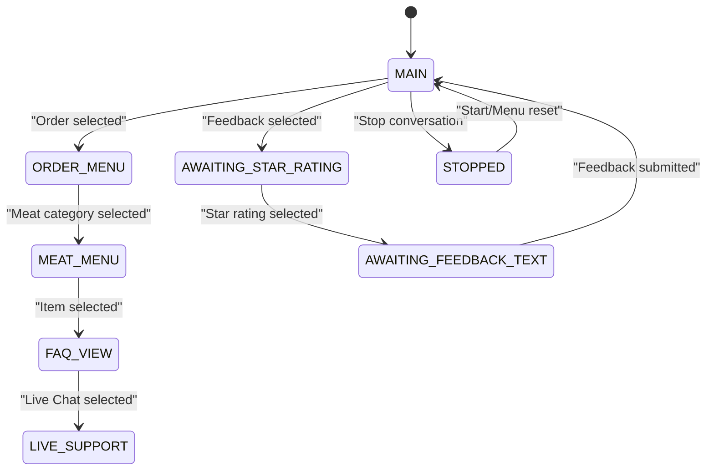
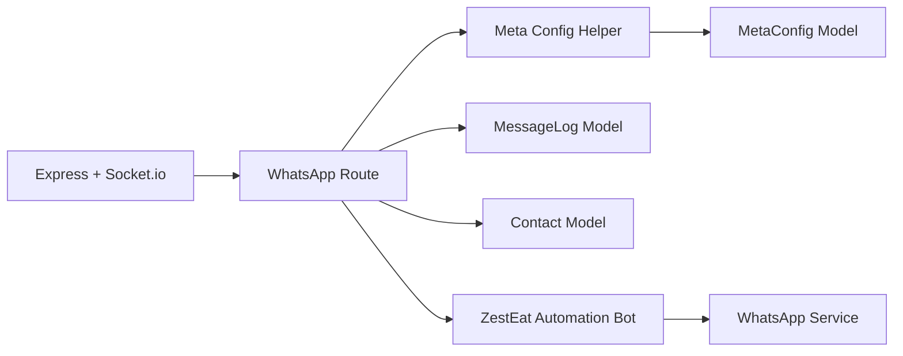

# Webhook Handling and Message Processing

<cite>
**Referenced Files in This Document**   
- [server.js](file://backend/server.js)
- [whatsapp.js](file://backend/routes/whatsapp.js)
- [MessageLog.js](file://backend/models/MessageLog.js)
- [Contact.js](file://backend/models/Contact.js)
- [MetaConfig.js](file://backend/models/MetaConfig.js)
- [metaConfigHelper.js](file://backend/utils/metaConfigHelper.js)
- [whatsappService.js](file://backend/utils/whatsappService.js)
- [zestEatAutomationBot.js](file://backend/utils/zestEatAutomationBot.js)
</cite>

## Table of Contents
1. [Introduction](#introduction)
2. [Project Structure](#project-structure)
3. [Core Components](#core-components)
4. [Architecture Overview](#architecture-overview)
5. [Detailed Component Analysis](#detailed-component-analysis)
6. [Dependency Analysis](#dependency-analysis)
7. [Performance Considerations](#performance-considerations)
8. [Troubleshooting Guide](#troubleshooting-guide)
9. [Conclusion](#conclusion)

## Introduction
This document explains the WhatsApp webhook handling and message processing architecture implemented in the backend. It covers:
- The webhook endpoint for verification, incoming message parsing, and status update handling
- The end-to-end flow from Meta’s webhook delivery to database storage and real-time broadcasting via WebSocket
- Support for text, button, and interactive message types
- Contact auto-upsert behavior on inbound messages
- Conversation context management through an automation bot engine
- Practical payload expectations, error handling strategies, debugging guidance, and performance considerations for high-volume scenarios

## Project Structure
The relevant backend structure for this documentation is centered around Express routes, models, utilities, and a Socket.io server:
- Entry point initializes Express, HTTP server, Socket.io, middleware, routes, MongoDB connection, and cron jobs
- WhatsApp route defines configuration endpoints, webhook verification, incoming message processing, status updates, and chat log retrieval
- Models define persistent schemas for message logs, contacts, and Meta configuration
- Utilities provide credential resolution, Meta API connectivity checks, outbound messaging helpers, and automation bot logic

**Diagram sources**
- [server.js:11-22](file://backend/server.js#L11-L22)
- [whatsapp.js:1-6](file://backend/routes/whatsapp.js#L1-L6)
- [MessageLog.js:1-22](file://backend/models/MessageLog.js#L1-L22)
- [Contact.js:1-26](file://backend/models/Contact.js#L1-L26)
- [MetaConfig.js:1-13](file://backend/models/MetaConfig.js#L1-L13)
- [metaConfigHelper.js:1-35](file://backend/utils/metaConfigHelper.js#L1-L35)
- [whatsappService.js:1-23](file://backend/utils/whatsappService.js#L1-L23)
- [zestEatAutomationBot.js:1-5](file://backend/utils/zestEatAutomationBot.js#L1-L5)

**Section sources**
- [server.js:11-80](file://backend/server.js#L11-L80)
- [whatsapp.js:1-56](file://backend/routes/whatsapp.js#L1-L56)

## Core Components
- Webhook Endpoint: GET and POST handlers under `/api/whatsapp/webhook`
  - GET verifies subscription with Meta using a verify token
  - POST processes incoming messages and status updates
- Message Storage: `MessageLog` model persists each inbound/outbound message and its lifecycle status
- Contact Auto-Upsert: Inbound messages automatically create or update a contact record
- Real-Time Broadcasting: Socket.io emits events for new messages and status updates
- Credential Management: `metaConfigHelper` resolves credentials from MongoDB or environment variables and validates connectivity
- Outbound Messaging: `whatsappService` formats payloads and sends text, images, buttons, lists, and templates
- Automation Bot: `zestEatAutomationBot` manages conversation state and replies based on user input

**Section sources**
- [whatsapp.js:114-311](file://backend/routes/whatsapp.js#L114-L311)
- [MessageLog.js:1-22](file://backend/models/MessageLog.js#L1-L22)
- [Contact.js:1-26](file://backend/models/Contact.js#L1-L26)
- [metaConfigHelper.js:6-35](file://backend/utils/metaConfigHelper.js#L6-L35)
- [whatsappService.js:45-215](file://backend/utils/whatsappService.js#L45-L215)
- [zestEatAutomationBot.js:12-394](file://backend/utils/zestEatAutomationBot.js#L12-L394)

## Architecture Overview
The system receives webhooks from Meta, parses them into structured data, stores them in MongoDB, optionally triggers automation flows, and broadcasts updates to connected clients via WebSocket.

**Diagram sources**
- [whatsapp.js:114-311](file://backend/routes/whatsapp.js#L114-L311)
- [MessageLog.js:1-22](file://backend/models/MessageLog.js#L1-L22)
- [Contact.js:1-26](file://backend/models/Contact.js#L1-L26)
- [zestEatAutomationBot.js:368-393](file://backend/utils/zestEatAutomationBot.js#L368-L393)
- [whatsappService.js:61-215](file://backend/utils/whatsappService.js#L61-L215)

## Detailed Component Analysis

### Webhook Verification and Incoming Message Parsing
- Verification:
  - GET `/api/whatsapp/webhook` reads query parameters `hub.mode`, `hub.verify_token`, and `hub.challenge`
  - Compares provided token with configured verify token from credentials or environment
  - Returns 200 with challenge when valid; otherwise returns 403 or 400
- Incoming Message Parsing:
  - POST `/api/whatsapp/webhook` checks for `body.object === "whatsapp"` and nested structure containing `entry[0].changes[0].value.messages`
  - Extracts sender phone, message ID (wamid), type, and text content
  - Supports message types:
    - text: uses `text.body`
    - button: uses `button.text` or `button.payload`
    - interactive: uses `interactive.button_reply.title` or `interactive.list_reply.title`
  - Normalizes phone numbers and determines WABA and phone number IDs from metadata or credentials

**Diagram sources**
- [whatsapp.js:134-311](file://backend/routes/whatsapp.js#L134-L311)

**Section sources**
- [whatsapp.js:114-132](file://backend/routes/whatsapp.js#L114-L132)
- [whatsapp.js:134-234](file://backend/routes/whatsapp.js#L134-L234)

### Status Update Handling
- Detects status entries in `entry[0].changes[0].value.statuses`
- Extracts:
  - `id` (wamid)
  - `recipient_id` (phone)
  - `status` (sent, delivered, read, failed)
  - `timestamp` (converted from seconds to Date)
  - Optional `errors` array for failure details
  - Optional `pricing` object
- Updates existing `MessageLog` by wamid with new status, error code/message, and pricing
- Emits `status_update` event with updated log data

**Section sources**
- [whatsapp.js:236-301](file://backend/routes/whatsapp.js#L236-L301)

### Database Storage: MessageLog Model
- Fields include:
  - Unique identifier `wamid`
  - Phone number and direction (INCOMING/OUTGOING)
  - Lifecycle status and textual content
  - Sender name, template name, header image URL, buttons
  - Timestamp, error code/message, pricing
  - Contextual identifiers `phoneId` and `wabaId`
- Used for both inbound and outbound records, including automated replies

**Diagram sources**
- [MessageLog.js:1-22](file://backend/models/MessageLog.js#L1-L22)

**Section sources**
- [MessageLog.js:1-22](file://backend/models/MessageLog.js#L1-L22)

### Contact Auto-Upsert Functionality
- On inbound messages, the system ensures a contact exists for the sender phone
- Uses `findOneAndUpdate` with upsert to:
  - Set last status and update timestamp
  - On insert, set identity and source fields
- Keeps contact list synchronized with active WhatsApp conversations

**Diagram sources**
- [whatsapp.js:189-204](file://backend/routes/whatsapp.js#L189-L204)
- [Contact.js:1-26](file://backend/models/Contact.js#L1-L26)

**Section sources**
- [whatsapp.js:189-204](file://backend/routes/whatsapp.js#L189-L204)
- [Contact.js:1-26](file://backend/models/Contact.js#L1-L26)

### Real-Time Broadcasting via WebSocket
- Socket.io server initialized in the main app and attached to Express
- Events emitted:
  - `new_message`: includes saved inbound message log
  - `status_update`: includes wamid, status, phone, and updated log
  - `auto_reply`: includes automated reply log created by bot engine
- Clients can join rooms and receive targeted broadcasts if needed

**Diagram sources**
- [server.js:14-35](file://backend/server.js#L14-L35)
- [whatsapp.js:206-211](file://backend/routes/whatsapp.js#L206-L211)
- [whatsapp.js:293-297](file://backend/routes/whatsapp.js#L293-L297)
- [zestEatAutomationBot.js:386-389](file://backend/utils/zestEatAutomationBot.js#L386-L389)

**Section sources**
- [server.js:14-35](file://backend/server.js#L14-L35)
- [whatsapp.js:206-211](file://backend/routes/whatsapp.js#L206-L211)
- [whatsapp.js:293-297](file://backend/routes/whatsapp.js#L293-L297)
- [zestEatAutomationBot.js:386-389](file://backend/utils/zestEatAutomationBot.js#L386-L389)

### Conversation Context Management: ZestEat Automation Bot
- Maintains per-phone session state in memory (`userSessions`)
- Handles:
  - Stop conversation trigger and suppression
  - Main menu navigation
  - Order categories and meat selection menus
  - FAQ assistance and live support routing
  - Star rating and written feedback capture
- Sends interactive messages (buttons/lists) and falls back to plain text when necessary
- Records automated replies in `MessageLog` and emits `auto_reply` via WebSocket

**Diagram sources**
- [zestEatAutomationBot.js:23-51](file://backend/utils/zestEatAutomationBot.js#L23-L51)
- [zestEatAutomationBot.js:53-78](file://backend/utils/zestEatAutomationBot.js#L53-L78)
- [zestEatAutomationBot.js:80-111](file://backend/utils/zestEatAutomationBot.js#L80-L111)
- [zestEatAutomationBot.js:113-145](file://backend/utils/zestEatAutomationBot.js#L113-L145)
- [zestEatAutomationBot.js:147-196](file://backend/utils/zestEatAutomationBot.js#L147-L196)
- [zestEatAutomationBot.js:198-233](file://backend/utils/zestEatAutomationBot.js#L198-L233)
- [zestEatAutomationBot.js:235-310](file://backend/utils/zestEatAutomationBot.js#L235-L310)
- [zestEatAutomationBot.js:312-337](file://backend/utils/zestEatAutomationBot.js#L312-L337)

**Section sources**
- [zestEatAutomationBot.js:12-394](file://backend/utils/zestEatAutomationBot.js#L12-L394)

### Outbound Messaging Helpers
- Text messages: append opt-out instruction unless STOP detected
- Images: upload to Meta media endpoint if local file path; send link directly if URL
- Buttons: interactive button replies limited to three options
- Lists: sections and rows with truncation safeguards
- Templates: send approved Meta templates with optional components

**Section sources**
- [whatsappService.js:61-215](file://backend/utils/whatsappService.js#L61-L215)

### Configuration and Credentials
- Credentials resolved from MongoDB `MetaConfig` with fallback to environment variables
- Cached in-memory to reduce DB calls
- Connection validation performed against Meta Graph API before saving credentials
- Exposes endpoints to get current status, host info, config, and sync environment

**Section sources**
- [metaConfigHelper.js:6-35](file://backend/utils/metaConfigHelper.js#L6-L35)
- [metaConfigHelper.js:37-71](file://backend/utils/metaConfigHelper.js#L37-L71)
- [metaConfigHelper.js:73-100](file://backend/utils/metaConfigHelper.js#L73-L100)
- [whatsapp.js:8-36](file://backend/routes/whatsapp.js#L8-L36)
- [whatsapp.js:62-109](file://backend/routes/whatsapp.js#L62-L109)

## Dependency Analysis
Key dependencies and relationships:
- WhatsApp route depends on:
  - `metaConfigHelper` for credentials and validation
  - `MessageLog` for persistence
  - `Contact` for auto-upsert
  - `zestEatAutomationBot` for conversation flows
  - `whatsappService` for outbound messaging
- Socket.io is attached to Express app and used for real-time broadcasting
- MongoDB models encapsulate schema definitions for message logs, contacts, and meta configuration

**Diagram sources**
- [whatsapp.js:1-6](file://backend/routes/whatsapp.js#L1-L6)
- [zestEatAutomationBot.js:1-5](file://backend/utils/zestEatAutomationBot.js#L1-L5)
- [whatsappService.js:1-4](file://backend/utils/whatsappService.js#L1-L4)
- [metaConfigHelper.js:1-3](file://backend/utils/metaConfigHelper.js#L1-L3)
- [server.js:11-22](file://backend/server.js#L11-L22)

**Section sources**
- [whatsapp.js:1-6](file://backend/routes/whatsapp.js#L1-L6)
- [zestEatAutomationBot.js:1-5](file://backend/utils/zestEatAutomationBot.js#L1-L5)
- [whatsappService.js:1-4](file://backend/utils/whatsappService.js#L1-L4)
- [metaConfigHelper.js:1-3](file://backend/utils/metaConfigHelper.js#L1-L3)
- [server.js:11-22](file://backend/server.js#L11-L22)

## Performance Considerations
- High-volume webhook handling:
  - Use efficient indexing on `MessageLog.wamid` and `MessageLog.phone` to speed up upserts
  - Consider batching or queueing automation bot tasks to avoid blocking webhook responses
  - Monitor MongoDB latency and scale read replicas if necessary
- WebSocket scaling:
  - For multi-instance deployments, use a scalable adapter (e.g., Redis adapter) to broadcast across nodes
  - Limit room joins and optimize client-side listeners to reduce overhead
- Credential caching:
  - Keep in-memory cache for Meta credentials to minimize DB queries
  - Invalidate cache explicitly when credentials change
- Payload size limits:
  - JSON body limit is set to 50MB; ensure webhook payloads remain small and avoid unnecessary attachments in webhooks
- Error resilience:
  - Wrap DB operations in try/catch and continue processing other parts of the webhook payload
  - Log errors with contextual information (wamid, phone, status) for faster triage

[No sources needed since this section provides general guidance]

## Troubleshooting Guide
Common issues and resolutions:
- Webhook verification fails:
  - Ensure verify token matches between Meta Developer Portal and server configuration
  - Confirm GET `/api/whatsapp/webhook` responds with 200 and challenge
- No incoming messages received:
  - Validate that POST `/api/whatsapp/webhook` is reachable and returns 200
  - Check logs for parsing errors and confirm payload structure contains `entry[0].changes[0].value.messages`
- Status updates not updating UI:
  - Verify `status_update` events are emitted and clients subscribe correctly
  - Inspect logs for status parsing and DB upsert errors
- Contacts not appearing:
  - Confirm contact auto-upsert logic runs on inbound messages
  - Check phone normalization and unique constraints
- Automation bot not responding:
  - Review session state transitions and stop suppression logic
  - Validate outbound message sending and fallback behavior

**Section sources**
- [whatsapp.js:114-132](file://backend/routes/whatsapp.js#L114-L132)
- [whatsapp.js:134-311](file://backend/routes/whatsapp.js#L134-L311)
- [zestEatAutomationBot.js:23-51](file://backend/utils/zestEatAutomationBot.js#L23-L51)

## Conclusion
The WhatsApp webhook handling architecture integrates robust verification, flexible message parsing, reliable persistence, and real-time broadcasting. It supports multiple message types, maintains contact records automatically, and offers a comprehensive automation bot for conversational flows. With careful attention to performance and error handling, the system scales effectively for high-volume messaging while providing clear operational visibility through logs and WebSocket events.

[No sources needed since this section summarizes without analyzing specific files]