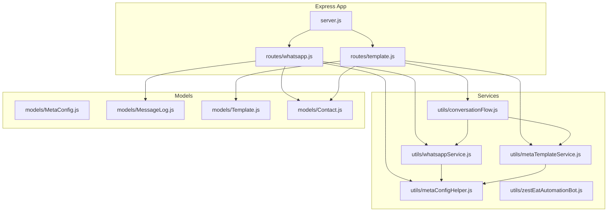
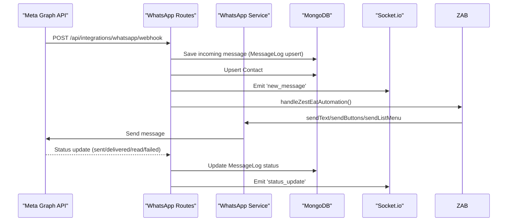
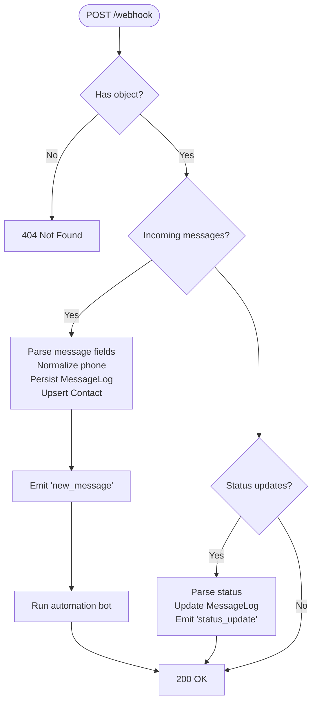
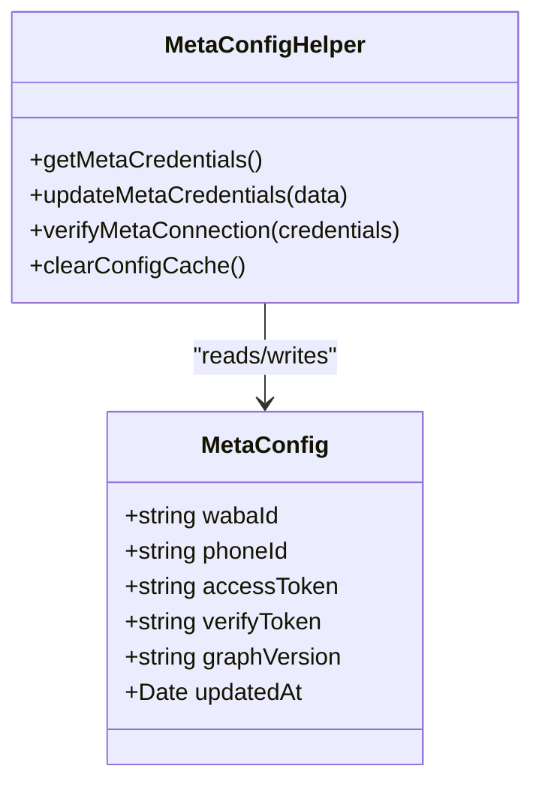
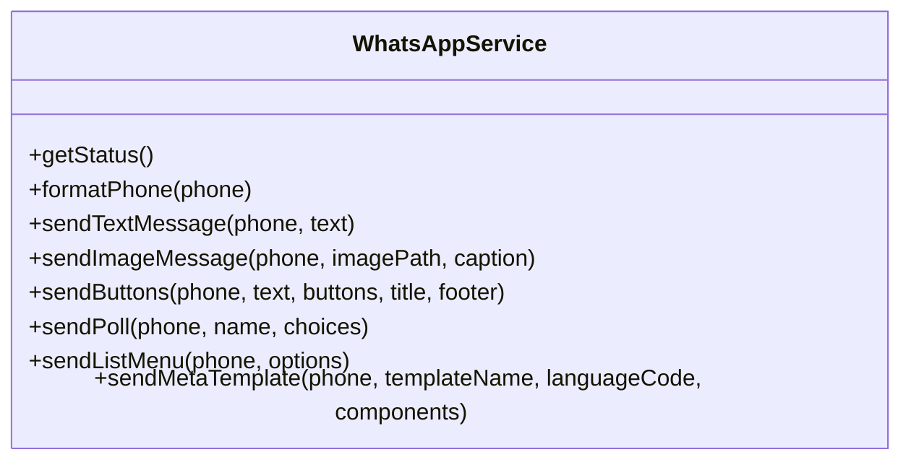
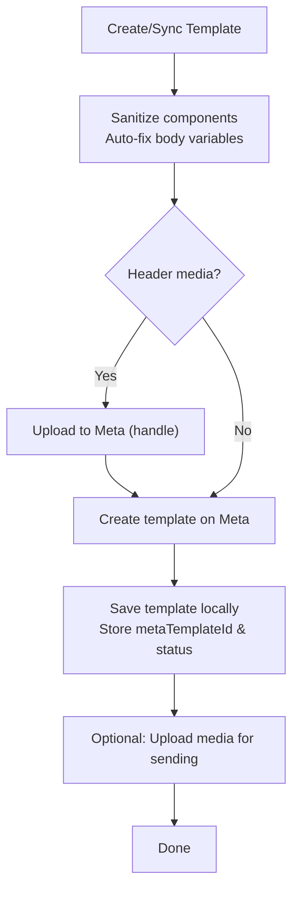
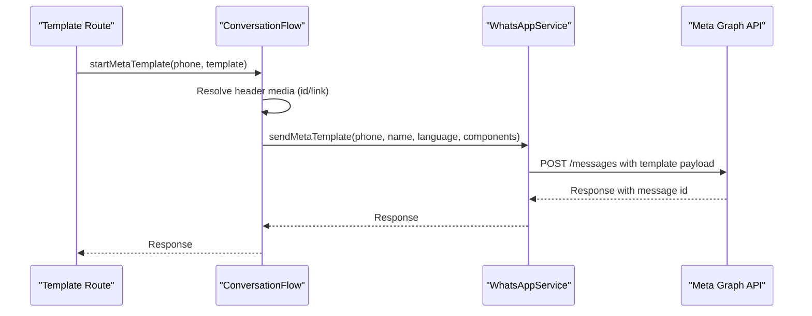
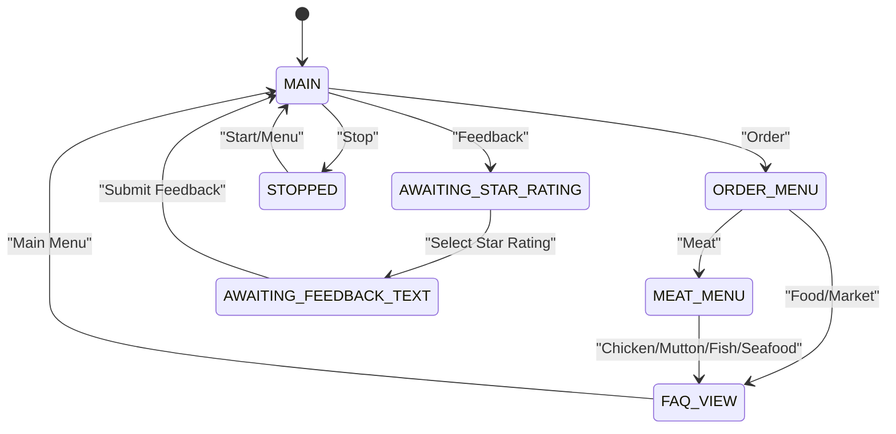
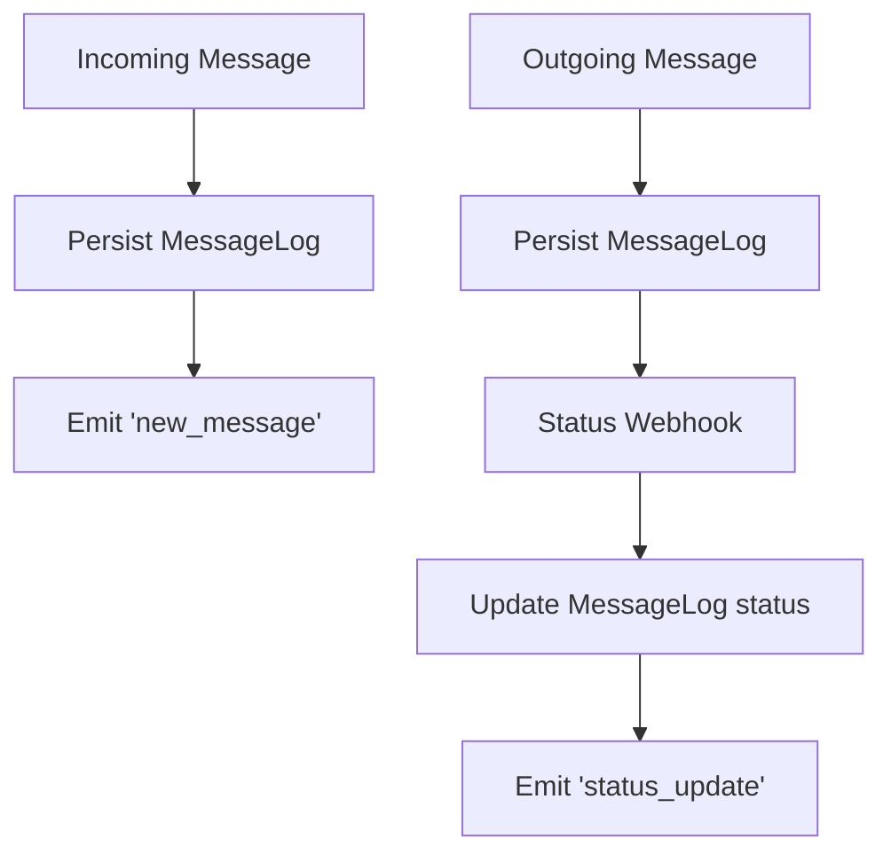
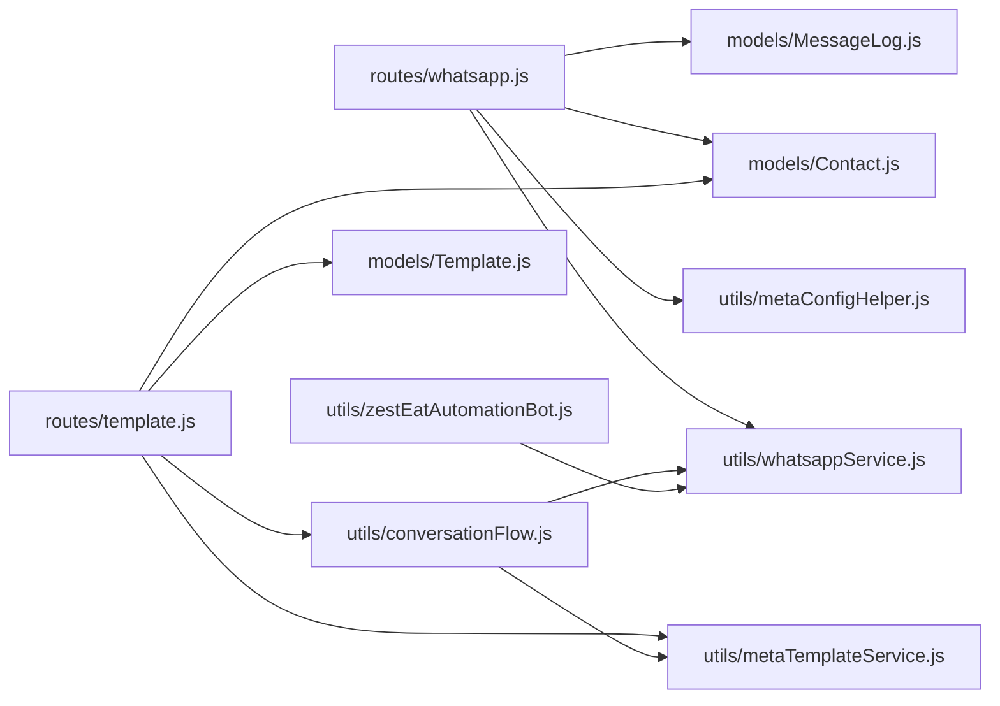

# WhatsApp Business Integration

<cite>
**Referenced Files in This Document**
- [server.js](file://backend/server.js)
- [whatsapp.js](file://backend/routes/whatsapp.js)
- [whatsappService.js](file://backend/utils/whatsappService.js)
- [metaConfigHelper.js](file://backend/utils/metaConfigHelper.js)
- [metaTemplateService.js](file://backend/utils/metaTemplateService.js)
- [template.js](file://backend/routes/template.js)
- [conversationFlow.js](file://backend/utils/conversationFlow.js)
- [zestEatAutomationBot.js](file://backend/utils/zestEatAutomationBot.js)
- [MetaConfig.js](file://backend/models/MetaConfig.js)
- [MessageLog.js](file://backend/models/MessageLog.js)
- [Template.js](file://backend/models/Template.js)
- [Contact.js](file://backend/models/Contact.js)
</cite>

## Table of Contents
1. [Introduction](#introduction)
2. [Project Structure](#project-structure)
3. [Core Components](#core-components)
4. [Architecture Overview](#architecture-overview)
5. [Detailed Component Analysis](#detailed-component-analysis)
6. [Dependency Analysis](#dependency-analysis)
7. [Performance Considerations](#performance-considerations)
8. [Troubleshooting Guide](#troubleshooting-guide)
9. [Conclusion](#conclusion)

## Introduction
This document explains the complete Meta Business API integration for WhatsApp, including webhook handling, message processing, template management, status tracking, media handling, and conversation automation. It covers the service layer architecture, configuration management for Meta API credentials, error handling for rate limits and failures, and end-to-end data flows from incoming webhooks to database storage and real-time broadcasting via WebSockets.

## Project Structure
The backend is an Express application with:
- Routes for WhatsApp endpoints and templates
- Service utilities for Meta Graph API calls
- Models for configuration, messages, templates, and contacts
- A WebSocket server for real-time updates
- Cron-based scheduled broadcasts

**Diagram sources**
- [server.js:43-56](file://backend/server.js#L43-L56)
- [whatsapp.js:1-6](file://backend/routes/whatsapp.js#L1-L6)
- [template.js:1-11](file://backend/routes/template.js#L1-L11)
- [whatsappService.js:1-4](file://backend/utils/whatsappService.js#L1-L4)
- [metaConfigHelper.js:1-2](file://backend/utils/metaConfigHelper.js#L1-L2)
- [metaTemplateService.js:1-4](file://backend/utils/metaTemplateService.js#L1-L4)
- [conversationFlow.js:1-7](file://backend/utils/conversationFlow.js#L1-L7)
- [zestEatAutomationBot.js:1-2](file://backend/utils/zestEatAutomationBot.js#L1-L2)
- [MetaConfig.js:1-12](file://backend/models/MetaConfig.js#L1-L12)
- [MessageLog.js:1-21](file://backend/models/MessageLog.js#L1-L21)
- [Template.js:1-40](file://backend/models/Template.js#L1-L40)
- [Contact.js:1-17](file://backend/models/Contact.js#L1-L17)

**Section sources**
- [server.js:1-82](file://backend/server.js#L1-L82)

## Core Components
- WhatsApp routes: Webhook verification, incoming message processing, status update handling, and message retrieval.
- WhatsApp service: Meta Graph API client for sending text, images, buttons, lists, polls, and templates; phone formatting; connection checks.
- Meta config helper: Credential resolution (MongoDB then environment), connection verification, cache control.
- Template service: Create, fetch, import, sync templates with Meta; upload media for templates and sending.
- Conversation flow: Prepare and send approved Meta templates with header media and body parameters.
- Automation bot: In-memory session state machine for order assistance, feedback collection, and stop/reset flows.
- Data models: MetaConfig, MessageLog, Template, Contact.

**Section sources**
- [whatsapp.js:1-335](file://backend/routes/whatsapp.js#L1-L335)
- [whatsappService.js:1-228](file://backend/utils/whatsappService.js#L1-L228)
- [metaConfigHelper.js:1-112](file://backend/utils/metaConfigHelper.js#L1-L112)
- [metaTemplateService.js:1-229](file://backend/utils/metaTemplateService.js#L1-L229)
- [conversationFlow.js:1-122](file://backend/utils/conversationFlow.js#L1-L122)
- [zestEatAutomationBot.js:1-399](file://backend/utils/zestEatAutomationBot.js#L1-L399)
- [MetaConfig.js:1-13](file://backend/models/MetaConfig.js#L1-L13)
- [MessageLog.js:1-22](file://backend/models/MessageLog.js#L1-L22)
- [Template.js:1-42](file://backend/models/Template.js#L1-L42)
- [Contact.js:1-26](file://backend/models/Contact.js#L1-L26)

## Architecture Overview
The system integrates with Meta’s Cloud API using a bearer token and WABA/phone identifiers. Incoming webhooks are processed to persist messages and statuses, while outgoing messages are sent through the service layer. Real-time UI updates are broadcast via Socket.io.

**Diagram sources**
- [whatsapp.js:114-311](file://backend/routes/whatsapp.js#L114-L311)
- [whatsappService.js:45-215](file://backend/utils/whatsappService.js#L45-L215)
- [zestEatAutomationBot.js:12-393](file://backend/utils/zestEatAutomationBot.js#L12-L393)
- [server.js:14-35](file://backend/server.js#L14-L35)

## Detailed Component Analysis

### Webhook Handling and Message Processing
- GET /webhook: Verifies subscription using hub.verify_token against configured verifyToken or env fallback.
- POST /webhook:
  - Processes incoming customer messages (text, button, interactive).
  - Normalizes phone numbers and persists to MessageLog with direction INCOMING and status received.
  - Upserts Contact record to ensure inbound senders appear in the contact list.
  - Emits real-time new_message event via Socket.io.
  - Invokes automation bot to respond based on session state.
  - Processes delivery/read/failure statuses, updating MessageLog and emitting status_update events.

**Diagram sources**
- [whatsapp.js:114-311](file://backend/routes/whatsapp.js#L114-L311)

**Section sources**
- [whatsapp.js:114-311](file://backend/routes/whatsapp.js#L114-L311)

### Configuration Management for Meta API Credentials
- getMetaCredentials:
  - Reads from MongoDB MetaConfig first; if present and valid, returns cached credentials.
  - Falls back to environment variables for token, WABA ID, phone ID, verify token, and graph version.
- updateMetaCredentials:
  - Validates credentials by calling Meta Graph API before saving.
  - Persists updated values and refreshes in-memory cache.
- verifyMetaConnection:
  - Pings Meta Graph API endpoint to confirm reachability and metadata.

**Diagram sources**
- [MetaConfig.js:1-12](file://backend/models/MetaConfig.js#L1-L12)
- [metaConfigHelper.js:6-104](file://backend/utils/metaConfigHelper.js#L6-L104)

**Section sources**
- [metaConfigHelper.js:1-112](file://backend/utils/metaConfigHelper.js#L1-L112)
- [MetaConfig.js:1-13](file://backend/models/MetaConfig.js#L1-L13)

### WhatsApp Service Layer
Responsibilities:
- Phone normalization for Meta API.
- Connection status check.
- Sending text, image, buttons, poll, list menu, and template messages.
- Media upload to Meta when required.

Key behaviors:
- sendRequest centralizes HTTP calls with Bearer authorization and error mapping.
- sendImageMessage supports both direct links and local file uploads to Meta’s media endpoint.
- sendMetaTemplate constructs template payloads with optional components.

**Diagram sources**
- [whatsappService.js:25-215](file://backend/utils/whatsappService.js#L25-L215)

**Section sources**
- [whatsappService.js:1-228](file://backend/utils/whatsappService.js#L1-L228)

### Template Management and Synchronization
Capabilities:
- Create templates on Meta with sanitized components and auto-fixed body variables.
- Fetch all templates from Meta and import into local database.
- Sync templates between Meta and local storage, deduplicating and preserving image assets.
- Upload media for templates and for sending, supporting resumable and multipart uploads.
- Validate template approval status before sending.

**Diagram sources**
- [metaTemplateService.js:23-136](file://backend/utils/metaTemplateService.js#L23-L136)
- [metaTemplateService.js:167-220](file://backend/utils/metaTemplateService.js#L167-L220)
- [template.js:283-365](file://backend/routes/template.js#L283-L365)

**Section sources**
- [metaTemplateService.js:1-229](file://backend/utils/metaTemplateService.js#L1-L229)
- [template.js:283-529](file://backend/routes/template.js#L283-L529)

### Conversation Flow Automation
- startMetaTemplate prepares header media (image/video/document) and body parameters for approved templates.
- Resolves media via Meta media ID or public URL; falls back to safe defaults if needed.
- Sends template via WhatsApp service and logs outcomes.

**Diagram sources**
- [conversationFlow.js:21-118](file://backend/utils/conversationFlow.js#L21-L118)
- [whatsappService.js:194-215](file://backend/utils/whatsappService.js#L194-L215)

**Section sources**
- [conversationFlow.js:1-122](file://backend/utils/conversationFlow.js#L1-L122)

### Automation Bot Engine
- Maintains per-phone sessions in memory for stateful interactions.
- Supports main menu, order categories, meat selection, FAQ, star rating, written feedback, live support, and stop/reset triggers.
- Uses buttons and list menus; gracefully falls back to plain text when interactive features fail.
- Logs auto-replies to MessageLog and emits auto_reply events via WebSockets.

**Diagram sources**
- [zestEatAutomationBot.js:12-393](file://backend/utils/zestEatAutomationBot.js#L12-L393)

**Section sources**
- [zestEatAutomationBot.js:1-399](file://backend/utils/zestEatAutomationBot.js#L1-L399)

### Database Storage and Real-Time Broadcasting
- MessageLog stores every outbound and inbound message with status, error details, pricing, and identifiers.
- Contacts are auto-upserted for inbound senders to maintain a unified contact list.
- Socket.io emits:
  - new_message for incoming messages
  - status_update for delivery/read/failure updates
  - auto_reply for automated bot responses

**Diagram sources**
- [whatsapp.js:170-211](file://backend/routes/whatsapp.js#L170-L211)
- [whatsapp.js:269-297](file://backend/routes/whatsapp.js#L269-L297)
- [zestEatAutomationBot.js:368-393](file://backend/utils/zestEatAutomationBot.js#L368-L393)

**Section sources**
- [MessageLog.js:1-22](file://backend/models/MessageLog.js#L1-L22)
- [Contact.js:1-26](file://backend/models/Contact.js#L1-L26)
- [server.js:14-35](file://backend/server.js#L14-L35)

## Dependency Analysis
High-level dependencies:
- Routes depend on services for API calls and on models for persistence.
- Services depend on metaConfigHelper for credential resolution.
- Templates route orchestrates template lifecycle and uses conversationFlow for sending.
- Automation bot depends on whatsappService for messaging primitives.

**Diagram sources**
- [whatsapp.js:1-6](file://backend/routes/whatsapp.js#L1-L6)
- [template.js:1-11](file://backend/routes/template.js#L1-L11)
- [conversationFlow.js:1-7](file://backend/utils/conversationFlow.js#L1-L7)
- [zestEatAutomationBot.js:1-2](file://backend/utils/zestEatAutomationBot.js#L1-L2)

**Section sources**
- [whatsapp.js:1-335](file://backend/routes/whatsapp.js#L1-L335)
- [template.js:1-644](file://backend/routes/template.js#L1-L644)
- [conversationFlow.js:1-122](file://backend/utils/conversationFlow.js#L1-L122)
- [zestEatAutomationBot.js:1-399](file://backend/utils/zestEatAutomationBot.js#L1-L399)

## Performance Considerations
- Rate limiting and throttling:
  - The template route implements a delay function with jitter to avoid overwhelming Meta APIs during bulk sends.
  - For Meta Cloud API, delays can be smaller than legacy clients due to higher throughput allowances.
- Concurrency:
  - Bulk sends iterate sequentially to respect rate limits and reduce errors.
- Media handling:
  - Prefer uploading once and reusing media IDs where possible; avoid redundant uploads.
- Caching:
  - Meta credentials are cached in memory to reduce DB reads and network calls.

[No sources needed since this section provides general guidance]

## Troubleshooting Guide

Common issues and resolutions:
- Missing or invalid Meta credentials:
  - Ensure WABA ID, phone ID, and access token are set either in MongoDB MetaConfig or environment variables.
  - Use the status endpoint to verify connectivity and inspect error messages.
- Webhook verification failures:
  - Confirm hub.verify_token matches the configured verifyToken or environment variable.
  - Ensure the endpoint is publicly reachable and configured in Meta dashboard.
- Template creation errors:
  - Body variables must be normalized to {{1}}, {{2}}, etc., and cannot start/end with a variable without surrounding text.
  - Header IMAGE format requires a valid handle or link; otherwise, remove or fix the component.
- Media upload failures:
  - Verify file paths, MIME types, and sizes.
  - Ensure access token has permissions for media uploads.
- Delivery/read/failure statuses:
  - Inspect errorCode and errorMessage in MessageLog for detailed failure reasons.
  - Monitor status_update events for real-time diagnostics.

Operational tips:
- Use the sync endpoints to keep local templates aligned with Meta.
- Validate template approval status before sending campaigns.
- Leverage stats summary to monitor sent, delivered, read, and failed counts.

**Section sources**
- [whatsapp.js:8-22](file://backend/routes/whatsapp.js#L8-L22)
- [whatsapp.js:114-131](file://backend/routes/whatsapp.js#L114-L131)
- [metaTemplateService.js:23-70](file://backend/utils/metaTemplateService.js#L23-L70)
- [metaTemplateService.js:167-220](file://backend/utils/metaTemplateService.js#L167-L220)
- [template.js:106-152](file://backend/routes/template.js#L106-L152)
- [template.js:560-623](file://backend/routes/template.js#L560-L623)

## Conclusion
This integration provides a robust, production-ready WhatsApp Business API solution with comprehensive webhook handling, reliable message processing, synchronized template management, and real-time broadcasting. It includes practical safeguards for rate limits, clear error reporting, and automation workflows that enhance user engagement. By following the configuration and troubleshooting guidance, teams can deploy and operate a scalable WhatsApp messaging system integrated with Meta’s Cloud API.